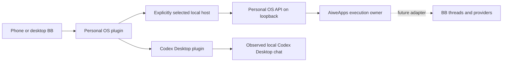

# Personal OS integration

Baseline: upstream `26de548d5454614e3957960eb8a83b7ead33e781`, 22 October 2026.
Fork: https://github.com/mr-procrastinator/bb. Origin is the fork; upstream remains get-bb/bb.
The local fork runs with the Personal OS panel, bounded owner input, saved instruction/result pages
and an explicit Codex Desktop chat opener. Task links belong to Personal OS and pin the task version,
semantic context and observed Desktop UUID. Codex and Claude native login health was observed ready.
A BB provider pilot was attempted and held with `invalid_content_type`; no model result is confirmed,
and the piloted provider is disabled.
Phone access and an AiweApps execution adapter remain unverified or unimplemented.

## Ownership



Personal OS keeps user goals, priorities, goal requirements, decisions, received exact artifacts,
consumer inspection, and acceptance of the overall goal. AiweApps keeps product requirements,
the product plan, one dispatch owner, budgets, resource fences, and domain quality/acceptance of its delivery.
BB keeps its conversations, environments, and provider sessions. Tasks is not a second editable copy
of Personal OS tasks. The Personal OS plugin reads existing owner APIs and sends bounded owner input,
without model execution. Its command ledger records transport recovery, not another task database.

## First implementation

`plugins/personal-os` is the first bounded code slice. UI and CLI use typed server RPC, which calls
the configured host entry. Only the host reads `http://127.0.0.1:7317`, so a future cloud BB server
does not mistake its own localhost for the user's Mac. No public Personal OS port or browser credentials.
Reads cover goals/tasks, bounded instruction lists/details, explicit task activity and exact attached
or task-bound research results. Bounded text input uses only the existing personal-inbox or pinned-goal
input POST. There is no arbitrary URL, redirect or browser-selected host.
`/api/control` is excluded: its skill catalog snapshot can write skill-version observations.

Show mission selection, actual tasks by state, and task details. Unknown and disconnected sources
are visible, not empty successful results. `doing` is a saved task status, not proof of a live process.
CLI reads use the same typed path as the panel. A build is not UI or product acceptance.

Owner input fixes one UUID, exact text, target, goal version and enrolled host before delivery.
The plugin stores that command before contacting Personal OS. Retry reuses it and the owner's
idempotency key; an uncertain outcome does not create a new UUID. The browser preserves its draft
and pending request across reload, without automatic submission. General input stays in the personal
inbox. Goal input requires the explicit goal/version. No task-status write, dispatch or automatic
execution is added. Detailed limits live in `plugins/personal-os/README.md`.

## Task activity and result views

The implemented UI keeps task status separate from execution evidence. `MissionBoard` reads one
bounded mission activity batch for its cards. `TaskActivity` reads the selected task separately.
Neither read starts work. A recorded continuation phase describes a saved attempt, not a live process.

| Existing component | Visible state and limit |
| --- | --- |
| `TaskActivityBadge` | One short card label for a recorded attempt, saved autostart setup, received-file record, scoped review or current error. An explicitly empty, fully covered execution scope adds no badge. Unknown coverage and read errors remain visible; omitted tasks are not treated as never started. |
| `TaskActivity` / `ExecutionStages` | The selected current attempt has three stages: **Исполнение → Файл → Проверка файла**. **Другие попытки** distinguishes current, historical and unknown bindings. More than one attempt may match the current conditions. A limited history stays marked incomplete. |
| File action | **Проверить и прочитать** appears only for an exact binding with a received research receipt. `not_rechecked` is permission to ask the owner reader to check the file, not proof that its bytes are currently readable. Missing or unavailable file data supplies no file action. |
| `TaskResultPage` | Reads that exact task/binding result, including an early file before instruction attachment. The host verifies size and SHA-256 before returning structured text. The page also checks the returned mission/task/binding against its route. Research conclusions describe the supplied material snapshot, not current system status. |
| Review text | A saved owner review requires its review identity and outcome. Current conclusions additionally require current binding/candidate and applicability. A saved review-run phase alone does not establish a review, task completion or goal acceptance. |
| Completion grounds | A done task separately resolves its exact artifact receipt and pinned consumer review. A historical execution binding stays historical after the task version changes. The exact file reader also shows these recorded grounds; the previous attempt review moves into history only when an exact current applicable completion review is present. Neither record establishes whole-goal acceptance. |
| Independent reads | Task ID, mission ID, version and context-current flag must agree between the displayed task and activity. A mismatch displays **Обновите данные задачи** and withholds current labels and file actions. A task-chat link also checks the displayed task version before enabling navigation. |
| Autostart errors | The current dispatcher error is separate from the saved attempt phase. Past dispatcher errors stay in expandable history; they do not replace the current phase. |

The overview starts with the goal and four task columns. Completed work shows three current cards
with an explicit expansion of the received list; this order does not claim completion recency.
The top input action opens and focuses the existing composer. A single plugin scroll viewport covers
all route content, the composer and recent instructions, inside BB's constrained host pane.
The composer and recent-instruction list appear only on overview pages. The composer remains mounted
while hidden on task/instruction/result pages, preserving the draft and pending request. Route keys
have separate component prefixes; board → task → back must leave one instruction list on the board
and none on the detail. Manual refresh is still explicit. Returning from a task does not establish
that every saved task field was reread.

The two full research readers render report text as restricted Markdown, including GFM tables with
contained horizontal overflow. HTML and media are excluded. Only absolute HTTPS links are active;
collapsed previews keep links as text. Clamping preserves the full Markdown input rather than cutting
a table mid-row.

This section describes the implemented source contract. Root's specific live route/result checks are
recorded below; source review is not visual acceptance of every state.
The native Personal OS research/review path observed below is separate from a BB provider turn.
The attempted provider pilot has no confirmed model result. Active-provider crash recovery also
remains unverified. A task badge, file or scoped review does not change those boundaries.

### Next compact UX step — proposed, not implemented

Keep the existing path: `MissionBoard` goal → `TaskDetail` task → `TaskActivity` attempt →
`ExecutionStages` file/review → `TaskResultPage` exact file. The missing visible level is the selected
attempt: its main `ExecutionStages` block has no attempt caption, while the other attempts already
have explicit labels inside **Другие попытки**.

Add a short **Попытка по текущим условиям** caption to that selected block; do not imply it is the only current attempt. Keep its three stage labels and one
file action together. Reuse the existing goal/task titles and back buttons for context; do not add
another list or a header status report. Keep historical attempts and past-error explanations folded.
Consolidate repeated evidence caveats locally instead of repeating them above the task's useful content.
This is a small hierarchy change in existing components, with no new data owner, status inference or
automatic action. The manual acceptance check is concrete: from one task detail, the owner can identify
the task's saved state, the selected attempt, the remaining file/review step and the exact file without
opening history. Historical and unknown states must still be distinguishable.

## Eight reviewed directions

| Direction | Existing capability | Remaining integration |
| --- | --- | --- |
| Multiple Codex accounts | Experimental Account Pooler, separate OAuth entries, ordered failover | A fixed account per chat and separate CODEX_HOME profiles are not implemented by the pool |
| Claude and other agents | Codex and Claude installed; native-login health observed ready; thread limits configured | BB provider pilot held with `invalid_content_type`, no confirmed model result, piloted provider disabled; native nested agents remain outside the BB thread counter |
| Phone | Responsive web UI, native mobile shell, pairing, voice pipeline | Configure authenticated HTTPS access; a cloned fork does not make the Mac reachable |
| Codex Desktop | Dedicated local snapshot list/search and allowlisted opener; one known chat opened and title matched | No automatic BB/provider/Desktop ID mapping; stale snapshots and absent chats remain bounded by the source |
| Personal OS panel | Goal/task/instruction/result reads and bounded owner input through typed host RPC/CLI; exact retry ledger | No Tasks mirror, task-status writes or execution dispatch; pending drafts are browser-local |
| AiweApps adapter | BB thread creation, sending, events and stop APIs | Durable operation identity and exact stop/result receipts before native resource release |
| History and recovery | SQLite, plugin databases, thread storage, controlled owned-runtime restart and exact input retry verified | Active-provider crash recovery remains open; keep consistent backups and exact artifacts outside pruned tool output |
| Independent acceptance | Local board, bounded input retry and one Desktop opening observed | Full runtime recovery, provider execution and phone access remain separate acceptance steps |

Relevant owners: `plugins/account-pool`, `plugins/provider-codex`, `plugins/provider-claude-code`,
`plugins/concurrency-limit`, `plugins/personal-os`, `plugins/codex-desktop`, `apps/mobile`, `apps/connect`, `packages/plugin-sdk`,
`packages/server-contract/src/api/threads.ts`, and `packages/db/src/retained-event-output.ts`.

## Important contracts before dispatch

Public BB thread create/send currently lacks a caller idempotency key. Workflow completion notifications
are at-least-once. A lost HTTP response must not trigger a blind repeat. Keep durable operation identity,
payload hash, and reconciliation in the single execution owner. A successful `stop` response does not
prove the exact daemon turn stopped. Do not release AiweApps resource reservations on that alone,
and do not kill a shared provider process to stop one thread.

Keep `bbThreadId`, `providerThreadId`, and `codexDesktopThreadId` distinct. Never open a BB ID as a
Codex chat ID. A future handoff carries a bounded context packet and explicit bindings; it does not
silently start two runtimes on the same provider session. Phone requests to continue on Mac need
an acknowledged desktop action; opening a mobile link is not evidence of execution on the Mac.

BB event history is not a permanent exact-output archive. Large tool output is compacted and full
retained output expires. Preserve accepted result bytes and hashes in Personal OS artifacts.
Backups must include BB's SQLite database, plugin databases, thread storage, and relevant host metadata.

## Runtime and update boundary

The local runtime manager is `scripts/personal-os-runtime.mjs`. It owns only processes that it starts.
It uses the fixed isolated directory `~/.local/share/bb-personal-os`, server7319 and daemon7320 on
loopback. It does not enroll a host, copy authentication, enable providers, build, update, reset,
or install a login service. Setup is explicit and separate from ordinary start:

```sh
node scripts/personal-os-runtime.mjs setup
node scripts/personal-os-runtime.mjs status
node scripts/personal-os-runtime.mjs start
node scripts/personal-os-runtime.mjs stop
```

Setup defaults to Codex's bundled Node at
`~/.cache/codex-runtimes/codex-primary-runtime/dependencies/node/bin/node`.
Use `setup --node /absolute/path/to/node` to select it explicitly. Setup records its resolved path;
it requires Node24/ABI137. Repeating setup with a different checkout or Node path refuses to overwrite
the saved configuration. Commands can be invoked by another Node version, but the managed processes
always use the recorded Node24. Start checks required build outputs and loads the existing native
SQLite addon without opening a database. Missing builds or a different native ABI fail before launch.

Start requires existing nonempty `bb.db`, `auth.json`, and `host-id`. It checks their metadata and
reads only the public `host-id`, never authentication contents. Initial enrollment remains a separate explicit installation
step. Server startup still runs BB's own migrations and maintenance. Existing queued work and provider
configuration remain owned by BB; starting the server is not a promise that those existing workflows
cannot resume. Provider enablement remains an explicit BB configuration action; the manager does not
change it. Native-login readiness was observed before the provider pilot. The piloted provider was
later disabled; its held outcome is recorded below.

The manager pins the native user's home and strips inherited alternate provider profiles, BB routing,
account-pool variables, API-key/token/base-URL/FD overrides for Claude/Codex, and standard custom-provider
overrides from its child environment. It does not alter
the environment of any existing process or provider-native files. This avoids inherited paid-API
fallback; it does not inspect or change credentials already stored by BB or a native provider.
Telemetry is false. Direct server/daemon entries have no packaged update shim or daemon auto-updater.

Each start creates a detached supervisor, durable PID records and separate gzip stdout/stderr logs
for that run under `runtime-manager/`. There is no uncompressed log duplicate. The supervisor remains
after the invoking chat exits. After a computer restart, run `start` again; automatic login startup
is not installed. If either managed service exits, the supervisor stops its own peer and records the
failure. No unbounded restart loop is installed. Compressed logs are finalized on orderly shutdown;
an abrupt power loss may leave the latest gzip member without its footer.

Stop requires the saved PID, UID, process start time, exact executable/entry arguments and unique
owner marker to still match. It sends SIGTERM only to those exact owned processes and never adopts
or kills an occupied port. No force kill is used. A manually launched existing pilot is reported as an
unmanaged listener and is left running. `ownedListener` checks that the saved PID owns the port.
`ready` also requires server `/health` or daemon `/status` with `connected: true` and the saved public
host ID. These checks do not establish plugin or product acceptance.
If an interrupted `start` leaves `runtime-manager/launch.lock`, inspect its saved owner and `status`
before removing only that manager lock. Do not remove BB's daemon lock, auth, database or user data.

Never reuse `~/.bb` or the Personal OS runtime. `pnpm dev` and `start:worktree` compute their own
checkout-specific directory; they are not this persistent pilot merely because `BB_DATA_DIR` was
exported. Take a consistent snapshot before accepting upstream migrations. Existing data must not
be reset to make a new build start. The manager has no rollback or data-migration command.

Default local APIs rely on loopback trust and can execute commands/read files. For a phone use the
existing authenticated BB Connect path or a deliberately configured private HTTPS boundary. Protect
both HTTP and WebSocket; do not use a wildcard bind as authentication.

## Current verification

Fork identity and parent, local clone, upstream remote, and clean baseline were observed.
Eight independent source reviews produced the boundaries above. Those source-only reviews did not
log in, copy credentials, start providers, expose ports, or run tests. The first plugin build passed
both Turbo typecheck and prepare:bundled (9 successful tasks).
The dry execution graph contained build/generate/typecheck tasks, no test tasks. Generated artifacts
remain ignored. Only the plugin dependency closure and app-side build dependencies were installed;
root install scripts were not run. The lockfile preserves upstream entries and adds the plugin importer.

A first manual call to the built host entry read the live loopback Personal OS APIs: missions, the
selected active mission, and 11 tasks (3 doing, 3 todo, 1 blocked, 4 done). Public fields exclude raw
evidence locators, workspace and context/history payloads. That initial observation covered only the
host reader; the later server/CLI/UI observations are recorded below. Phone access remains unverified.
Private evidence is stored outside checkout as compressed plugin-build-final and plugin-live-host
records. The SDK build also passed. No successful BB model result was part of that initial verification.
Automated tests were not run.

Independent reviews checked contract/host boundaries and UI source. Two UI findings were corrected:
historical results now remain reachable outside current Done, and an unspecified executor stays
explicitly unknown. Mission and task reads are separate observations, not an atomic cross-API snapshot.
The fork runtime subsequently compiled successfully: app, server, host daemon, CLI, and required
workers. Nine selected builtin plugin runtimes were prepared; all of their expected JS entries exist.
Native SQLite, node-pty and Parcel were loaded with Node24.19.0 / ABI137. The local Homebrew Node23
does not match this SQLite build: use the same Node runtime, or explicitly rebuild native dependencies
for a different supported Node version.

## Observed local pilot

The fork runs on loopback `http://127.0.0.1:7319`, with one local host daemon on7320 and its own
data directory. The host is enrolled only in this fork instance. Existing provider auth files were
not copied. Telemetry is disabled; the direct source runtime does not run the packaged update shim.
The operator completed explicit manager setup, stopped the prior manual processes and started the
manager-owned pair. Both processes had exact ownership and ready checks. A later full manager
stop/restart verification is still in progress; login-startup and24/7 operation are not established.

The Personal OS plugin is installed and running. Real CLI calls went through server RPC and the
enrolled host to Personal OS. They returned the selected mission and its11original tasks. Server restart
preserved the plugin configuration, host binding and subsequent reads. Four BB work items were then
added through the existing Personal OS owners; the old11tasks were checked unchanged.

In Chrome, the operator opened Personal OS from the BB sidebar, selected the mission, opened a task,
returned to the board and reopened after reload and rebuilding. The board then showed15real tasks.
A live UI defect was corrected: current Done cards now display their result instead of an obsolete
next action. The final plugin typecheck/build passed. Private screenshot:
`evidence/personal-os-board-20261022.png` in the isolated runtime, outside Git.
That board pass did not validate a BB model result. Automated tests were not run.
Native mobile and remote access remain unverified.

The input flow was exercised in Chrome. A draft survived reload. The first submission then reported
`storage_unavailable`: the installed ledger had already applied migration0 with its original hash,
but the changed source tried to replace that statement. The fix restored immutable migration0 and
appended migration1. The same pending request was retried and saved exactly one new Personal OS note.
The five existing inbox entries stayed unchanged; the inbox then contained six entries. The new note
was subsequently triaged to `planned`; that state does not mean its requested work was executed.
The plugin still calls the real Personal OS owners and does not relocate or replace their database.

At initial setup, global and local-host BB thread limits were 8. Codex 0.153.4 and Claude 2.1.308 were
installed, enabled and reported ready by provider health. The native Claude CLI reported Team. A plan-label projection defect
was corrected; BB health then also reported Team. These observations do not prove a successful BB
model result. The later held provider pilot is recorded below. Native memory, provider subagents and BB Workflows remain off.
The thread counter does not itself bound native nested agents. Account/Connect services, automation
and unprepared optional plugins remain disabled; phone access is not presented as connected.

The Codex Desktop plugin's list RPC projected 65 local chats and explicitly omitted 29 unsupported
source rows. Search was available over the loaded list. In Chrome, the operator selected a known
chat and used the explicit opener. The native Codex window then showed that exact chat title.
This confirms that observed navigation only. The general opener receipt still says `open_requested`
with `navigationConfirmed:false`; there is no automatic BB-thread/provider-session/Desktop mapping,
message forwarding, Desktop resume or phone-side Codex execution.

The manager subsequently completed `stop` and `start`: both owned listeners disappeared, then both
services became healthy with the same enrolled host. The existing input command and exact saved
receipt survived; its command count remained one. Both finalized logs from the stopped run were
read successfully as gzip. This verifies a controlled restart, not recovery from a crash while a
provider model runs. Proof: `evidence/runtime-restart-proof-20261022.json.gz` outside checkout.

The first build also exposed a cache-path bug under Git2.23: `rev-parse --path-format=absolute`
returned the literal unsupported flag plus `.git` with exit0. React compiler cache was consequently
created under an invalid newline-containing directory in apps/app. `vite-react-compiler.ts` now uses
`--git-common-dir` and resolves it relative to the repository root. Both Git2.23 and2.53 returned the
same correct cache path; rebuilding under2.23 actually created it. Daemon worker hashes stayed unchanged.
Cause and before/after evidence are compressed in the isolated runtime. After source checkpoint
`4cedf3208` was committed, only the erroneous generated directory was removed: 38,850,560 allocated
bytes. No active process or worktree used it. The correct shared cache and user caches were retained.

The bundled skill metadata validator could not run because both available Python environments lack
PyYAML. Its small frontmatter and references were inspected directly; no behavioral skill evaluation
is claimed. Agents can discover the plugin's read commands through its shipped skill.

The instruction/result extension passed targeted Turbo typecheck and builds. The host read a real
attached research file, checked its exact size/SHA-256, and returned bounded structured text. Chrome
showed the original instruction, saved plan, partial result and full research on separate pages.
Reload retained the saved record. A real task binding was read through Personal OS; the task button
changed the native Codex window to the exact selected chat. An unlinked task showed that absence.
The general opener response still does not claim automatic window confirmation.

A live route regression was found and fixed: InputList and MissionBoard shared the same sibling key.
Board → task → back duplicated the instruction list. Distinct key prefixes fixed that same flow:
zero lists on task detail and one after returning. The reproduction screenshot remains outside Git.
Draft transport, immutable migrations and prior instructions were preserved.

A new BB goal instruction then passed Personal OS's explicitly enabled one-job research policy:
background triage published one typed task; the existing native runner produced one file; a separate
reviewer recorded a scoped review; the result was attached to that same instruction and displayed
inside BB. No BB provider model turn was used. This proves the bounded Personal OS path, not the future
AiweApps→BB execution adapter, phone access, full crash recovery or product acceptance. Research text
is labelled as conclusions from its supplied snapshot, not current system status.

### Latest task activity and provider checks

Root's Chrome pass covered the activity board without empty launch badges, a new task's exact file,
a historical task's exact file, and navigation back. The current and historical result views remained
separate. This confirms those specific navigation/read cases, not all activity branches or full UX
acceptance at 9/10.

The real generated report contained a five-signal Markdown table. Root expanded it and observed an
actual rendered table in Chrome, rather than literal pipe-delimited text. Proof:
`research-table-rendered-20261022.png`, retained outside Git. This is a table-rendering observation,
not a claim about every long report, narrow viewport or maximum-size document.

A BB provider pilot was attempted. It was held with `invalid_content_type`; no model result is
confirmed. The piloted provider is disabled. The held status does not establish whether a model ran,
and this record does not infer a provider-side cause from that error alone. The earlier no-provider
statements described the initial checks; they must not be read as saying no pilot was attempted.

A new timeline fix exists in source only. It has not been verified live, and the previously saved
history remains unrepaired. It must not be presented as recovered history or a successful provider
result.

### Manual UI checkpoint, 23 October 2026

Root observed the revised board in one Chrome tab: expand 3/8 to 8/8, task/detail/back with
expansion preserved, and done task → exact research file → attempt history → back. Draft text and
the explicit goal target survived reload and navigation; root cleared only that manual-check draft
without submitting new work. The exact 11886-byte research result and pinned review were readable.

Live inspection found two layout defects missed by source review: a flex-shrunk board overlapped
the composer, and the host overflow boundary clipped long content. Natural board height plus one
shared scroll viewport fixed both. Wheel scrolling reached the lower composer; the compact board
main measured 806px instead of 1494px. Build/typecheck passed; no automated tests ran.
Runtime evidence stays outside Git: `evidence/board-overlap-before-20261023.png`,
`evidence/board-compact-after-20261023.png`, and
`evidence/board-completion-manual-20261023.json.gz` under the isolated BB data directory.
These checks cover the observed desktop routes. Phone, microphone and owner-rated 9/10 remain open.
