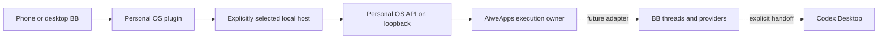

# Personal OS integration

Baseline: upstream `26de548d5454614e3957960eb8a83b7ead33e781`, 22 October 2026.
Fork: https://github.com/mr-procrastinator/bb. Origin is the fork; upstream remains get-bb/bb.
The fork exists. Provider login, remote access, and execution integration are not activated.

## Ownership

Personal OS keeps user goals, priorities, goal requirements, decisions, received exact artifacts,
consumer inspection, and acceptance of the overall goal. AiweApps keeps product requirements,
the product plan, one dispatch owner, budgets, resource fences, and domain quality/acceptance of its delivery.
BB keeps its conversations, environments, and provider sessions. Tasks is not a second editable copy
of Personal OS tasks. The Personal OS plugin reads existing owner APIs, without model execution.

## First implementation

`plugins/personal-os` is the first bounded code slice. UI and CLI use typed server RPC, which calls
the configured host entry. Only the host reads `http://127.0.0.1:7317`, so a future cloud BB server
does not mistake its own localhost for the user's Mac. No public Personal OS port or browser credentials.
Only explicit GET paths are allowed; no arbitrary URL, redirects, methods, or browser-selected host.
`/api/control` is excluded: its skill catalog snapshot can write skill-version observations.

Show mission selection, actual tasks by state, and task details. Unknown and disconnected sources
are visible, not empty successful results. `doing` is a saved task status, not proof of a live process.
CLI reads use the same typed path as the panel. A build is not UI or product acceptance.

## Eight reviewed directions

| Direction | Existing capability | Remaining integration |
| --- | --- | --- |
| Multiple Codex accounts | Experimental Account Pooler, separate OAuth entries, ordered failover | A fixed account per chat and separate CODEX_HOME profiles are not implemented by the pool |
| Claude and other agents | First-party Claude provider and ACP adapters | Verify the existing local login and set bounded concurrency; native nested agents are outside the BB thread counter |
| Phone | Responsive web UI, native mobile shell, pairing, voice pipeline | Configure authenticated HTTPS access; a cloned fork does not make the Mac reachable |
| Codex Desktop | Generic local app opener; Codex has deep links | Explicit chat mapping and a supported opener; BB currently restricts external URL schemes |
| Personal OS panel | Plugin SDK supports nav panels, typed host RPC and CLI | Read-only panel first; no Tasks mirror or second task database |
| AiweApps adapter | BB thread creation, sending, events and stop APIs | Durable operation identity and exact stop/result receipts before native resource release |
| History and recovery | SQLite, plugin databases, thread storage, provider resume | Consistent backup and exact artifact retention outside pruned BB tool output |
| Independent acceptance | Source boundaries reviewed | Manual local flow, repeat open, account identity, recovery, and phone access remain separate observations |

Relevant owners: `plugins/account-pool`, `plugins/provider-codex`, `plugins/provider-claude-code`,
`plugins/concurrency-limit`, `apps/mobile`, `apps/connect`, `packages/plugin-sdk`,
`packages/server-contract/src/api/threads.ts`, and `packages/db/src/retained-event-output.ts`.

## Important contracts before dispatch

Public BB thread create/send currently lacks a caller idempotency key. Workflow completion notifications
are at-least-once. A lost HTTP response must not trigger a blind repeat. Keep durable operation identity,
payload hash, and reconciliation in the single execution owner. A successful `stop` response does not
prove the exact daemon turn stopped. Do not release AiweApps resource reservations on that alone,
and do not kill a shared provider process to stop one thread.

Keep `bbThreadId`, `providerThreadId`, and `codexDesktopThreadId` distinct. Never open a BB ID as a
Codex chat ID. A future handoff carries a bounded context packet and explicit bindings; it does not
silently start two runtimes on the same provider session. Phone requests to continue on Mac need
an acknowledged desktop action; opening a mobile link is not evidence of execution on the Mac.

BB event history is not a permanent exact-output archive. Large tool output is compacted and full
retained output expires. Preserve accepted result bytes and hashes in Personal OS artifacts.
Backups must include BB's SQLite database, plugin databases, thread storage, and relevant host metadata.

## Runtime and update boundary

Use an explicit, separate `--data-dir` for a persistent pilot. Never reuse `~/.bb` or the Personal OS
runtime. `pnpm dev` and `start:worktree` compute their own checkout-specific dev directory; they are not
the persistent pilot directory merely because `BB_DATA_DIR` was exported.
Keep automatic in-app updates off for the pilot. Take a consistent snapshot before accepting upstream
migrations. Existing data must not be reset to make a new build start.

Default local APIs rely on loopback trust and can execute commands/read files. For a phone use the
existing authenticated BB Connect path or a deliberately configured private HTTPS boundary. Protect
both HTTP and WebSocket; do not use a wildcard bind as authentication.

## Current verification

Fork identity and parent, local clone, upstream remote, and clean baseline were observed.
Eight independent source reviews produced the boundaries above. They did not log in, copy credentials,
start providers, expose ports, or run tests. The first plugin build passed both Turbo typecheck and prepare:bundled (9 successful tasks).
The dry execution graph contained build/generate/typecheck tasks, no test tasks. Generated artifacts
remain ignored. Only the plugin dependency closure and app-side build dependencies were installed;
root install scripts were not run. The lockfile preserves upstream entries and adds the plugin importer.

A manual call to the built host entry read the live loopback Personal OS APIs: missions, the selected
active mission, and 11 tasks (3 doing, 3 todo, 1 blocked, 4 done). Public fields exclude raw evidence
locators, workspace and context/history payloads. This verifies the host reader against real data;
it does not prove BB server RPC, CLI routing, installation, phone access, or the BB panel UI.
Private evidence is stored outside checkout as compressed plugin-build-final and plugin-live-host
records. The SDK build also passed. No provider model or automated test was run.

Independent reviews checked contract/host boundaries and UI source. Two UI findings were corrected:
historical results now remain reachable outside current Done, and an unspecified executor stays
explicitly unknown. Mission and task reads are separate observations, not an atomic cross-API snapshot.
The fork runtime subsequently compiled successfully: app, server, host daemon, CLI, and required
workers. Nine selected builtin plugin runtimes were prepared; all of their expected JS entries exist.
Native SQLite, node-pty and Parcel were loaded with Node24.19.0 / ABI137. The local Homebrew Node23
does not match this SQLite build: use the same Node runtime, or explicitly rebuild native dependencies
for a different supported Node version.

## Observed local pilot

The fork is running on loopback `http://127.0.0.1:7319`, with one local host daemon on7320 and its own
data directory. The new host is enrolled only in this fork instance. Existing provider auth files were
not copied. Telemetry is disabled; this direct source runtime does not run the packaged update shim.
This is a manual local launch, not confirmed login-startup or a24/7 service.

The Personal OS plugin is installed and running. Real CLI calls went through server RPC and the
enrolled host to Personal OS. They returned the selected mission and its11original tasks. Server restart
preserved the plugin configuration, host binding and subsequent reads. Four BB work items were then
added through the existing Personal OS owners; the old11tasks were checked unchanged.

In Chrome, the operator opened Personal OS from the BB sidebar, selected the mission, opened a task,
returned to the board and reopened after reload and rebuilding. The board then showed15real tasks.
A live UI defect was corrected: current Done cards now display their result instead of an obsolete
next action. The final plugin typecheck/build passed. Private screenshot:
`evidence/personal-os-board-20261022.png` in the isolated runtime, outside Git.
No provider model or automated test was run. Native mobile and remote access remain unverified.

Global and local-host BB thread limits are8. This does not bound native nested provider agents;
configure those before enabling model execution. Providers, account/connect services, automation and
unprepared optional plugins remain disabled in this new pilot instance. This avoids presenting them
as working connections. Claude/Codex bundles exist; their actual login and model readiness are separate.

The first build also exposed a cache-path bug under Git2.23: `rev-parse --path-format=absolute`
returned the literal unsupported flag plus `.git` with exit0. React compiler cache was consequently
created under an invalid newline-containing directory in apps/app. `vite-react-compiler.ts` now uses
`--git-common-dir` and resolves it relative to the repository root. Both Git2.23 and2.53 returned the
same correct cache path; rebuilding under2.23 actually created it. Daemon worker hashes stayed unchanged.
Cause and before/after evidence are compressed in the isolated runtime. After source checkpoint
`4cedf3208` was committed, only the erroneous generated directory was removed: 38,850,560 allocated
bytes. No active process or worktree used it. The correct shared cache and user caches were retained.

The bundled skill metadata validator could not run because both available Python environments lack
PyYAML. Its small frontmatter and references were inspected directly; no behavioral skill evaluation
is claimed. Agents can discover the plugin's read commands through its shipped skill.
